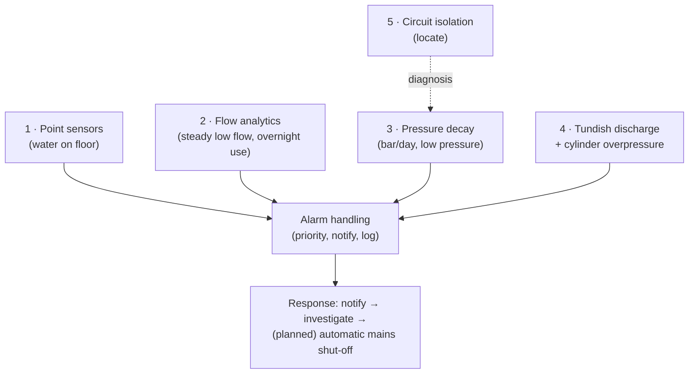

# Layered Leak Detection: From Point Sensors to Flow Analytics and Pressure Decay

**A whole-house water and heating leak-detection strategy built in layers, the way a BMS combines point detection, flow monitoring and pressure analysis. Each layer catches a different kind of leak: a sudden flood, a dripping tap or passing valve, a slow weep in a sealed heating system, or a safety-valve discharge from an unvented cylinder. This repo ties together monitoring documented across the water and heating projects.**

> **The short version:** no single sensor catches every leak, so five layers work together:
> 1. **Point sensors** where water appears
> 2. **Mains flow analytics** for leaks you can't see
> 3. **Sealed-system pressure decay** for heating weeps
> 4. **Safety-device discharge** at the cylinder tundishes
> 5. **Circuit isolation** to locate a leak
>
> Layers 1 and 2 are live; 3-5 are being installed with the plant-room monitoring.

**Portfolio position:** Automation level · leak detection and alarm strategy. Related: [Mains water metering](https://github.com/the-control-cabinet/mains-water-metering-modbus-rtu) · [Heating plant monitoring](https://github.com/the-control-cabinet/heating-plant-monitoring-esphome)

---

## 1. The layers

| Layer | What it detects | How | Speed | Status |
|---|---|---|---|---|
| **1. Point sensors** | Water on the floor (appliances, sinks, plant areas) | Zigbee water-leak sensors at wet locations | Seconds | ✅ Live |
| **2. Mains flow analytics** | Hidden leaks, dripping taps, passing toilet valves, a burst pipe | Clamp-on ultrasonic meter: **steady low flow for 10 min** alert, per-draw tracking, overnight usage | Minutes to hours | ✅ Live |
| **3. Sealed-system pressure decay** | Slow weeps in the heating primary circuit | Boiler pressure transducer: a daily same-condition reading → **bar/day decay**; low-pressure alarm | Days | 🚧 Sensor installed; calibration and analytics in progress |
| **4. Safety-device discharge** | Unvented cylinder relief discharge (expansion or overpressure) | **Tundish drip sensors** (pulsed plates) + cylinder inlet pressure rise | Seconds | 🚧 To install |
| **5. Circuit isolation** | *Where* the heating leak is | Isolate circuits one at a time; a proposed **UFH manifold pressure** sensor for a split-system test | Days | 📐 Planned |

## 2. Alarm priorities

| Priority | Condition | Response |
|---|---|---|
| **P1 (immediate)** | Point sensor wet · tundish discharge · very high continuous flow (burst) | Phone alert now; (planned) close the mains valve on a burst |
| **P2 (same day)** | Steady low flow for 10 min · cylinder inlet pressure > 5.0 bar · boiler pressure < 1.0 bar | Phone alert; investigate |
| **P3 (trend)** | Boiler pressure decay above baseline · rising overnight usage | Dashboard / weekly review |

## 3. Current case: a slow heating leak
- The primary circuit loses about **0.25 bar a week** (1.5 → 1.0 bar over two weeks).
- The boiler's own expansion vessel has been ruled out.
- **Plan:** a daily cold-condition reading for the decay rate, then isolate circuits one at a time, and check the PRV discharge, auto air vents and joints. Details: [heating plant repo, doc 04](https://github.com/the-control-cabinet/heating-plant-monitoring-esphome/blob/main/docs/04-pressure-and-leak-diagnosis.md).

## 4. Lessons
- **Point sensors catch only what reaches them.** Flow and pressure analytics catch what you can't see.
- **Compare like with like.** Heating pressure varies with temperature, so the decay is measured at the same condition each day.
- **Safety-valve discharge is a symptom.** A tundish drip points to an expansion or overpressure problem upstream.

## 5. Roadmap
- [ ] Complete layers 3-5 (calibration, tundish sensors, cylinder inlet pressures, manifold pressure).
- [ ] **Automatic mains shut-off valve** (motorised), triggered by P1 burst/flood conditions, with a manual override.
- [ ] A unified leak dashboard and an alarm-priority implementation (feeds the alarm and trend strategy project).

## 6. Skills demonstrated

| Skill | Evidence |
|---|---|
| Layered detection design | Five complementary layers, each matched to a leak type |
| Alarm prioritisation | P1-P3 with defined responses |
| Analytics | Steady-flow detection, same-condition pressure decay |
| Diagnosis method | Circuit isolation and split-system pressure testing |

📺 [The Control Cabinet on YouTube](https://www.youtube.com/channel/UC5Cupmz7vlfcodpCX7k8iuQ)

*Built and documented by James · part of [The Control Cabinet BMS portfolio](https://github.com/the-control-cabinet). MIT Licence.*
